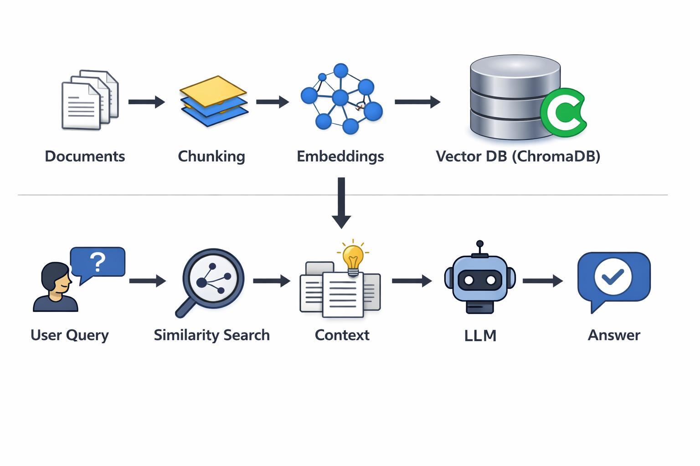

# AI Document Assistant using RAG

An AI-powered document assistant that allows users to upload documents and ask questions using Retrieval-Augmented Generation (RAG).

The application retrieves relevant information from uploaded documents and generates context-aware answers using open-source language models.

## Project Objectives

- Upload and process multiple document formats.
- Extract text from PDF, DOCX, TXT, and Markdown files.
- Split documents into smaller chunks.
- Generate embeddings using open-source embedding models.
- Store and retrieve document vectors using ChromaDB.
- Generate answers using a local LLM.
- Display source documents and citations with answers.

## Technology Stack

| Component | Technology |
|---|---|
| Programming Language | Python |
| Frontend | Streamlit |
| Document Processing | PyPDF, python-docx |
| Text Chunking | Custom Python module |
| Embedding Model | Sentence Transformers |
| Vector Database | ChromaDB |
| LLM | Open-source model |
| Version Control | Git and GitHub |

## Project Architecture

```text
User
 |
 v
Document Upload
 |
 v
Document Loader
 |
 v
Text Chunking
 |
 v
Embedding Generation
 |
 v
ChromaDB Vector Store
 |
 v
Similarity Search
 |
 v
LLM Answer Generation
 |
 v
Answer with Source Citations
```

## Project Structure

```text
ai-document-assistant/
|
|-- src/
|   |-- __init__.py
|   |-- document_loader.py
|   |-- text_chunker.py
|
|-- data/
|   |-- sample.md
|
|-- tests/
|   |-- __init__.py
|   |-- test_document_loader.py
|   |-- test_text_chunker.py
|   |-- test_pipeline_loading.py
|
|-- requirements.txt
|-- .gitignore
|-- README.md
```



## Implementation Progress

### Step 1: Document Loading and Text Extraction

**Objective:** Extract text from different document formats and convert it into a common structured format.

**Supported formats:**
- PDF
- DOCX
- TXT
- Markdown

**Libraries used:**
- pypdf
- python-docx

**Implementation:**

Created `src/document_loader.py` with the following functions:

- `load_pdf()` – extracts text page by page.
- `load_text_file()` – reads TXT and Markdown files.
- `load_docx()` – extracts Word document paragraphs.
- `load_document()` – identifies the file format and selects the appropriate loader.

**Important learning:**

1. Different document formats require different extraction methods.
2. PDF text extraction can preserve page-level information.
3. Document metadata is important for source citations.
4. A common document structure makes the RAG pipeline modular.

**Testing:**

```powershell
python -m tests.test_document_loader
```

**Status:** Completed.

### Step 2: Text Chunking

**Objective:** Divide extracted documents into smaller text passages for efficient retrieval.

**Concepts learned:**

- Chunk size
- Chunk overlap
- Word boundary preservation
- Metadata preservation

**Implementation:**

Created `src/text_chunker.py` with:

- `split_text()` – splits text into overlapping chunks.
- `chunk_documents()` – processes document records and preserves source metadata.

**Initial configuration:**

| Parameter | Value |
|---|---:|
| Chunk size | 500 characters |
| Chunk overlap | 100 characters |

These are initial experimental values, not final optimized settings.

**Why chunking is important:**

- Reduces the amount of irrelevant information.
- Makes semantic retrieval more efficient.
- Helps retrieve relevant passages.
- Preserves context using overlapping text.

**Testing:**

```powershell
python -m tests.test_text_chunker
python -m tests.test_pipeline_loading
```

**Status:** Completed.


### Step 3: Open-Source Embedding Generation

**Objective:** Convert document chunks into numerical vector representations using a locally executed open-source embedding model.

**Model used:**
- Model: all-MiniLM-L6-v2
- Framework: Sentence Transformers
- Embedding dimension: 384
- Execution: Local CPU/GPU

**Implementation:**

Created `src/embeddings.py` containing:

- `EmbeddingGenerator` – manages the embedding model.
- `generate_embeddings()` – converts text into numerical vectors.
- `embed_chunks()` – generates embeddings while preserving chunk metadata.

**Concepts learned:**

1. Embeddings represent the semantic meaning of text numerically.
2. Semantically similar sentences should have similar vector representations.
3. Embedding dimensions determine the size of the resulting vectors.
4. Normalized embeddings simplify cosine similarity calculations.
5. Open-source embedding models can run locally without an external API.

**Testing:**

```powershell
python -m tests.test_embeddings
python -m tests.test_embedding_pipeline
```

**Important observation:**

The selected model produces 384-dimensional embeddings and has a maximum input sequence length of 256 word pieces. Input length must be considered when designing chunking strategies.

**Status:** Completed.


### Step 4: ChromaDB Vector Database

**Objective:** Store document embeddings, text chunks, and source metadata in a persistent vector database and retrieve relevant passages through semantic similarity search.

**Technology used:**
- ChromaDB
- Python
- Sentence Transformers
- all-MiniLM-L6-v2

**Implementation:**

Created `src/vector_store.py` containing:

- `VectorStore` – manages the ChromaDB database.
- `add_chunks()` – stores document chunks, embeddings, and metadata.
- `search()` – retrieves relevant passages using query embeddings.
- `count()` – returns the number of stored records.
- `_generate_id()` – generates deterministic chunk IDs.

**Concepts learned:**

1. What is a vector database?
2. Difference between relational databases and vector databases.
3. How ChromaDB stores embeddings and metadata.
4. Cosine similarity and cosine distance.
5. Semantic search and top-k retrieval.
6. Persistent vector storage.
7. Upsert operations and duplicate prevention.

**Database configuration:**

| Parameter | Value |
|---|---|
| Database | ChromaDB |
| Storage | Local persistent storage |
| Collection | document_collection |
| Distance metric | Cosine |
| Embedding dimension | 384 |

**Testing:**

```powershell
python -m tests.test_vector_store
python -m tests.test_persistence
```

**Important learning:**

ChromaDB allows semantic retrieval by comparing the embedding of a user query against previously stored document embeddings.

Lower cosine distance indicates greater vector similarity.

**Status:** Completed.


### Step 5: Document Retriever

**Objective:** Retrieve relevant document chunks based on the semantic meaning of user questions.

**Implementation:**

Created `src/retriever.py` containing:

- `DocumentRetriever` – manages semantic retrieval.
- `retrieve()` – converts user questions into embeddings and retrieves matching document chunks.
- Top-K retrieval – controls the number of retrieved results.
- Distance threshold – filters less relevant results.

**Concepts learned:**

1. What is a retriever in RAG?
2. Query embedding generation.
3. Top-K retrieval.
4. Cosine similarity and cosine distance.
5. Similarity threshold filtering.
6. Source metadata preservation.
7. Retrieval quality evaluation.

**Retrieval configuration:**

| Parameter | Initial value |
|---|---:|
| Embedding model | all-MiniLM-L6-v2 |
| Top-K | 3 |
| Distance metric | Cosine |
| Experimental threshold | 0.60 |

**Testing:**

```powershell
python -m tests.test_retriever
python -m tests.test_retrieval_threshold
```

**Important learning:**

A retriever finds relevant passages from stored documents using semantic similarity. A smaller cosine distance generally indicates a closer match.

Retrieval quality directly affects the quality of the final RAG-generated answer.

**Status:** Completed.


### Step 6: Local LLM Integration using Ollama

**Objective:** Integrate an open-weight language model running locally to generate natural-language responses.

**Technology used:**
- Ollama
- Qwen2.5 3B Instruct
- Python urllib
- Local HTTP API

**Implementation:**

Created `src/llm_client.py` containing:

- `OllamaClient` – manages communication with Ollama.
- `chat()` – sends conversation messages to the local model.
- `generate()` – generates responses from text prompts.

**Concepts learned:**

1. What is a Large Language Model?
2. Difference between embedding models and generative models.
3. Local LLM inference using Ollama.
4. HTTP API communication.
5. System prompts and user prompts.
6. Temperature and response generation.
7. Prompt-based answer grounding.

**Model configuration:**

| Parameter | Value |
|---|---|
| Runtime | Ollama |
| Model | qwen2.5:3b |
| Execution | Local |
| API endpoint | localhost:11434/api/chat |
| Streaming | Disabled |

**Testing:**

```powershell
python -m tests.test_llm_client
python -m tests.test_llm_prompt
```

**Important learning:**

The embedding model converts text into numerical vectors for semantic search, whereas the LLM generates human-readable responses.

Ollama allows the application to run an open-weight language model locally without depending on an external LLM API.

**Status:** Completed.


## Step 7: Complete RAG Pipeline

Implemented the complete Retrieval-Augmented Generation pipeline
by integrating the retriever and local LLM.

### Workflow

1. Accept a user question.
2. Convert the question into an embedding.
3. Retrieve relevant document chunks from ChromaDB.
4. Build context using retrieved document chunks.
5. Send the context and question to the local Ollama LLM.
6. Generate an answer using the supplied context.
7. Return the answer along with source metadata.

### Main Components

- `src/rag_pipeline.py`: Connects retrieval and generation.
- `src/retriever.py`: Finds relevant document chunks.
- `src/llm_client.py`: Communicates with the Ollama API.
- `src/vector_store.py`: Retrieves stored document chunks.

### Run the Integration Test

```bash
python -m tests.test_rag_pipeline
```

### Current Features

- Local LLM integration using Ollama.
- Context-based answer generation.
- Source metadata returned with answers.
- Empty retrieval handling.
- Configurable context length.

## Step 8: Streamlit User Interface

Implemented a Streamlit interface for the AI Document Assistant.

### Features
- Upload PDF, DOCX, TXT and Markdown files.
- Automatic document loading and chunking.
- Embedding generation using Sentence Transformers.
- Persistent storage using ChromaDB.
- Question-answering through a chat interface.
- Source metadata display.

### Run Application

```bash
python -m streamlit run app.py


